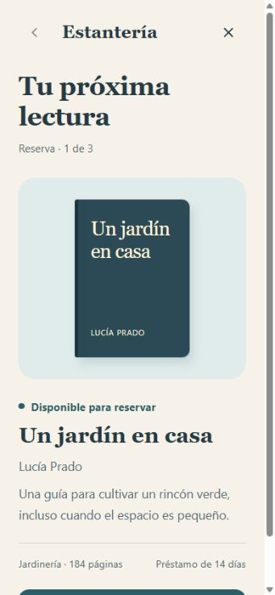
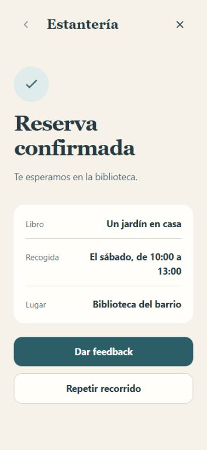
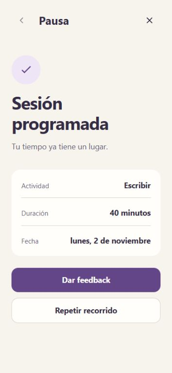

# improve-design

[English](README.md)

Mejora una interfaz mediante mockups de alta fidelidad y prototipos interactivos
con recorridos completos. Revisa el resultado, recoge feedback y mantén alineados
el diseño, el prototipo y las capturas cuando cambien las decisiones.

## Casos de uso

Estos dos ejemplos ejecutables muestran los puntos de partida disponibles. Con
mockups existentes, conserva sus decisiones visuales. Sin mockups, crea una
dirección coherente directamente en alta fidelidad. Ambos modos pueden producir
un único mockup estático cuando no hace falta interacción.

Los ejemplos usan una interfaz en español y datos ficticios. Ejecuta los prompts
desde la raíz de este repositorio. En otro proyecto, cambia las rutas y usa sus
referencias de diseño. Son prompts de uso, no transcripciones de una generación
independiente.

### 1. Con mockups: reservar un libro

Conserva la apariencia editorial de la biblioteca al completar una reserva.
La franja de recogida elegida debe aparecer en el recibo final.

#### Prompt

```text
Usa $improve-design con examples/with-mockups/mockup.jpg como referencia.
Conserva su tipografía, colores, espaciado, contenido e interfaz en español.
Construye la reserva completa: consultar disponibilidad, elegir recogida,
revisar, confirmar y ver el recibo de la reserva.
Presenta la información del escenario antes de Iniciar y después deja que use
la app sin instrucciones de revisión encima. Recoge mi feedback al llegar al final.
Guarda la propuesta en review/book-reservation/.
```

#### Capturas

| Mockup de referencia | Reserva completada |
| --- | --- |
|  |  |

[Detalles del ejemplo](examples/with-mockups/README.es.md) ·
[Archivo del prototipo](examples/with-mockups/index.html)

La referencia se creó a partir del estado inicial del ejemplo, con el mismo
contenido y componentes. No es una traducción independiente desde una herramienta
de diseño externa. Las pantallas posteriores amplían esa dirección visual.

### 2. Sin mockups: programar una sesión

Crea la dirección visual y un recorrido completo. La sesión programada debe
conservar la actividad, duración y fecha elegidas.

#### Prompt

```text
Usa $improve-design para diseñar un planificador sencillo de concentración.
No tengo mockups. Crea una interfaz coherente de alta fidelidad en español.
Déjame elegir actividad, ajustar duración y fecha, revisar los datos, confirmar
y ver la sesión programada antes de dar feedback.
Incluye validación útil y navegación hacia atrás que conserve mis elecciones.
Guarda la propuesta en review/focus-session/.
```

#### Capturas



[Detalles del ejemplo](examples/without-mockups/README.es.md) ·
[Archivo del prototipo](examples/without-mockups/index.html)

Para una pregunta visual más pequeña, pide un único mockup de alta fidelidad:

```text
Usa $improve-design para mejorar la jerarquía de esta tarjeta de cuenta.
Un mockup de alta fidelidad basta. No necesito navegación ni índice de escenarios.
```

## Instalación

Usa Node.js 22.20 o posterior y npm, como requiere la
[CLI skills](https://github.com/vercel-labs/skills#install-a-skill).
Desde tu proyecto, ejecuta:

```bash
npx skills add jerolan/improve-design
```

Selecciona la skill y los agentes donde quieres instalarla. Por defecto, la
instalación corresponde al proyecto actual. Para instalar sólo esta skill en
Codex y usarla entre proyectos:

```bash
npx skills add jerolan/improve-design --skill improve-design -a codex -g
```

Para consultar las skills disponibles sin instalar:

```bash
npx skills add jerolan/improve-design --list
```

Consulta la [referencia de instalación de la CLI](https://github.com/vercel-labs/skills/blob/main/docs/commands.md#skills-add)
para otros agentes y opciones.

## Uso y revisión

Invoca `$improve-design` y describe la interfaz, la tarea de la persona y las
decisiones que deben conservarse. Aporta los archivos de diseño, capturas o
recursos existentes.

Un prototipo con varios escenarios comienza con un índice. Al elegir un
escenario aparecen el contexto, los pasos y el resultado esperado. **Iniciar**
abre una vista como la app, sin instrucciones de revisión. La persona completa
el recorrido, ve el resultado y deja su feedback. La navegación libre puede ser
una opción adicional.

Una pantalla o un escenario breve no necesitan índice. Ambos modos requieren
alta fidelidad; la cantidad de interacción depende de lo que se quiere revisar.
Antes de entregar, compara el resultado visual con la referencia y recorre cada
flujo anunciado hasta su resultado final.

El feedback parcial sigue siendo parcial. Las decisiones aceptadas se conservan
en las revisiones. Aprobar un diseño no autoriza implementar ni desplegar el producto.

## Ejecutar los ejemplos localmente

Descarga o clona este repositorio y abre el `index.html` de cada ejemplo.
No requieren dependencias de aplicación ni servicios externos.

Si ya tienes Python, también puedes servir el repositorio localmente:

```bash
python3 -m http.server 8765 --bind 127.0.0.1
```

Abre [el ejemplo con mockups](http://127.0.0.1:8765/examples/with-mockups/) o
[el ejemplo sin mockups](http://127.0.0.1:8765/examples/without-mockups/).
Detén el servidor con `Ctrl+C`. Esta dirección sólo funciona en la computadora
que sirve los archivos. El teléfono requiere una configuración de red local autorizada.

Los ejemplos simulan las operaciones en memoria. Guardan feedback en el
navegador cuando dispone de almacenamiento y permiten descargarlo. Los comentarios
no llegan automáticamente al agente ni a otro dispositivo. Si el almacenamiento
no está disponible, expórtalos antes de cerrar la página.

## Compatibilidad y verificación

La skill no exige un editor, framework o plugin concreto. Usa las herramientas
disponibles en el proyecto. Renderizar, interactuar con el navegador y comprobar
capturas requiere herramientas que lo permitan; las comprobaciones bloqueadas
deben indicarse.

Se recorrieron ambos ejemplos hasta su resultado.
[VALIDATION.md](VALIDATION.md) recoge las comprobaciones y sus límites.
Los ejemplos no crean reservas de biblioteca ni eventos de calendario reales.

## Licencia

[MIT](LICENSE), Copyright 2026 jerolan.
