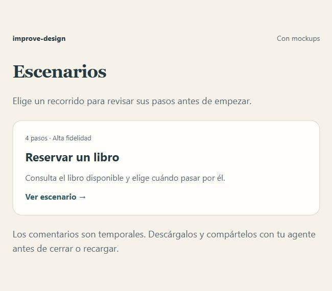
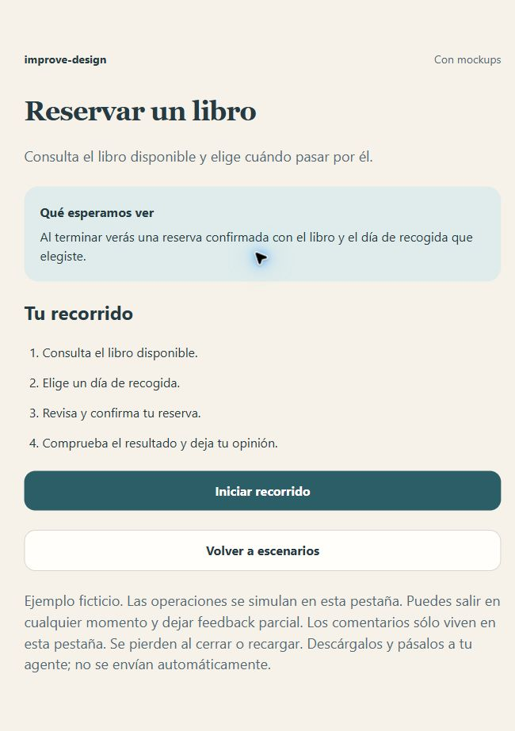
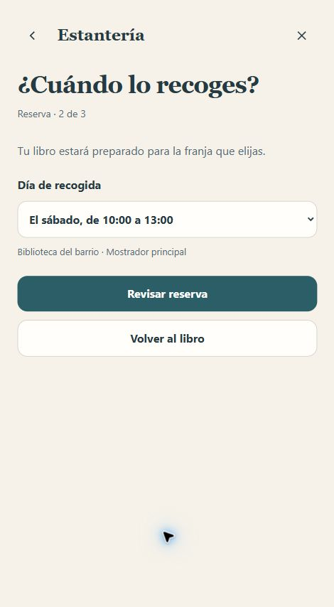
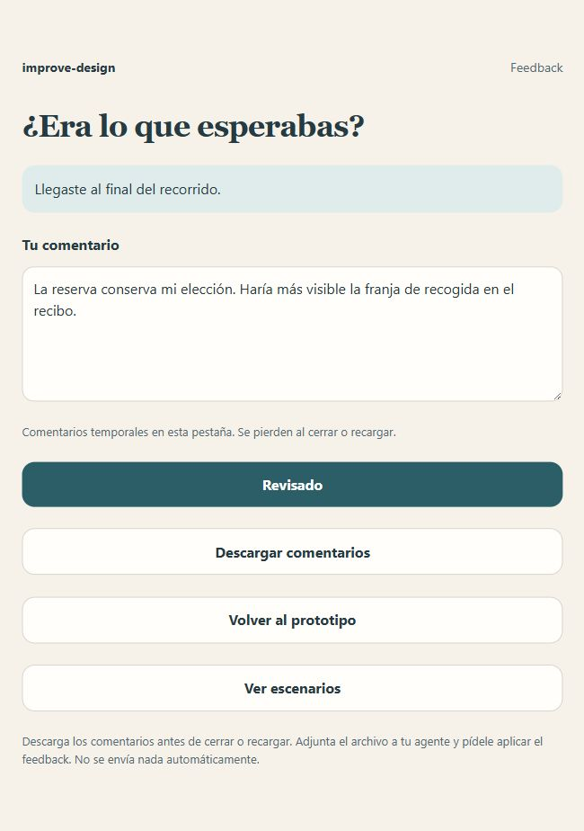
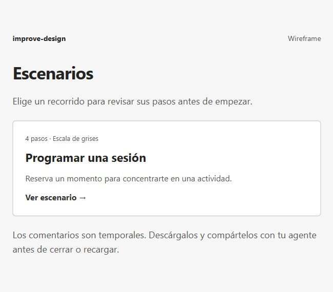
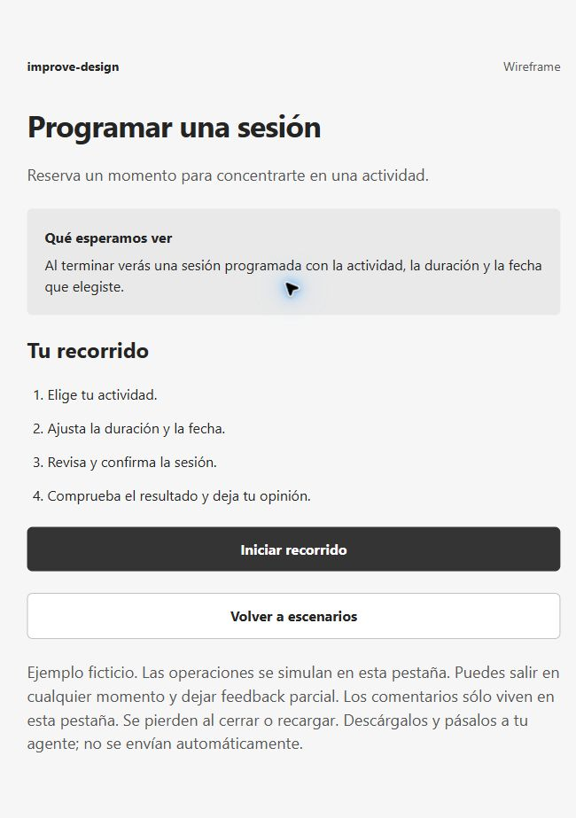
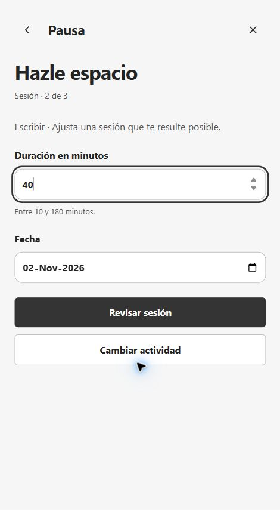
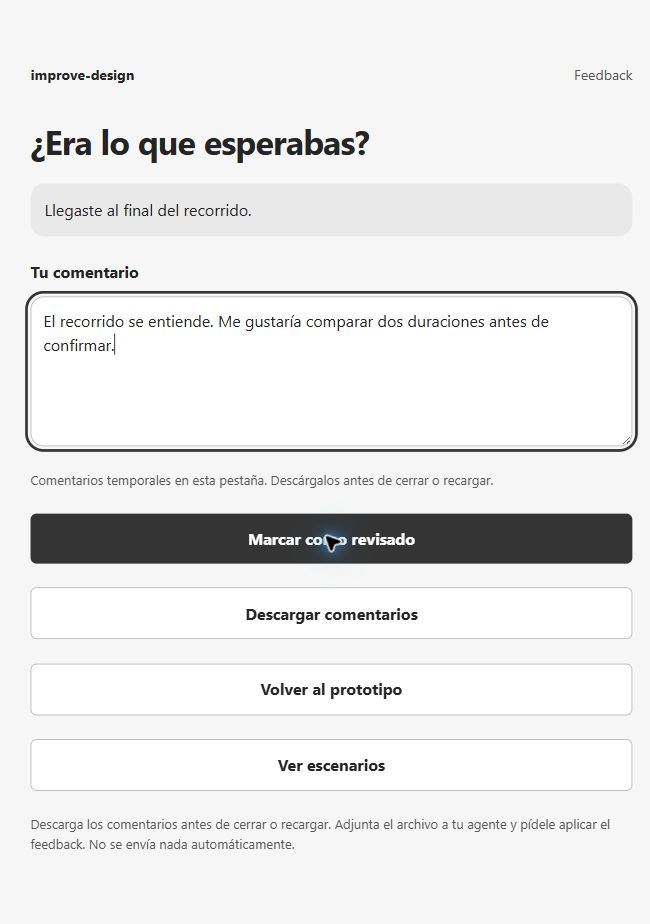

# improve-design

[Español](README.es.md)

Review interface improvements through a visual proposal, a complete interactive
journey, and feedback. Preserve existing design decisions when references exist.
When requested, use a grayscale wireframe to review structure and interaction.

## Use cases

The examples use Spanish interface copy and fictitious data. Each shows four
review stages: scenario list, scenario details, interaction, and feedback.
The prompts are examples, not transcripts of independent generation runs.

### 1. With mockups: reserve a book

Preserve the existing library design and confirm the selected collection window.

#### Prompt

```text
Use $improve-design with examples/with-mockups/mockup.jpg as the reference.
Preserve its typography, colors, spacing, content, and Spanish interface copy.
Show the scenario list and details, then Start the complete reservation:
availability, collection window, review, confirmation, and receipt.
Show the feedback form after the result. Save under review/book-reservation/.
```

#### Screenshots

| 1. Scenario list | 2. Scenario details |
| --- | --- |
|  |  |

| 3. Interactive scenario | 4. Feedback form |
| --- | --- |
|  |  |

[Reference mockup](examples/with-mockups/mockup.jpg) ·
[Example details](examples/with-mockups/README.md) ·
[Prototype file](examples/with-mockups/index.html)

The reference was created from the example's initial state. It is not an
independent translation from an external design tool.

### 2. Wireframe: schedule a focus session

With no supplied mockups, this example uses black, white, and gray. The session
must retain the selected activity, duration, and date through confirmation.
A missing mockup alone does not require a wireframe; choose visual fidelity for
the task and the user's request.

#### Prompt

```text
Use $improve-design to create a grayscale wireframe of a focus-session planner.
Show the scenario list and details, then Start the interactive flow.
Let me select an activity, duration and date, review, confirm, and see
the scheduled session. Show a feedback form after the result.
Keep the interface in Spanish. Save under review/focus-session/.
```

#### Screenshots

| 1. Scenario list | 2. Scenario details |
| --- | --- |
|  |  |

| 3. Interactive scenario | 4. Feedback form |
| --- | --- |
|  |  |

[Example details](examples/without-mockups/README.md) ·
[Prototype file](examples/without-mockups/index.html)

## Installation

Use Node.js 22.20 or later and npm, as required by the
[skills CLI](https://github.com/vercel-labs/skills#install-a-skill):

```bash
npx skills add jerolan/improve-design
```

Select the skill and agents. Installation is project-local by default.
For Codex across projects:

```bash
npx skills add jerolan/improve-design --skill improve-design -a codex -g
```

To inspect available skills without installing:

```bash
npx skills add jerolan/improve-design --list
```

## Review and feedback

Choose a scenario, read its context and expected result, and select **Start**.
Complete the interactive flow through its final result before giving feedback.
For a single visual question, a static mockup may be enough.

Feedback is temporary in the current tab. Navigation and replay retain comments;
closing or reloading loses them. Download the Markdown comments before leaving.
Attach the file to your agent or paste its contents as a prompt. Nothing is sent
or synchronized automatically.

```text
Use $improve-design to apply the attached feedback. Preserve accepted decisions
and verify each changed flow through its final result.
```

## Run the examples locally

Download or clone the repository and open each example's `index.html` in a
browser. GitHub displays the HTML source. No application dependencies or external
services are needed. With Python installed, run from the repository root:

```bash
python3 -m http.server 8765 --bind 127.0.0.1
```

Open [with mockups](http://127.0.0.1:8765/examples/with-mockups/) or
[wireframe](http://127.0.0.1:8765/examples/without-mockups/). Stop with Ctrl+C.
The address is local to the computer. Operations are fictitious.

The skill does not require a specific editor, framework, or plugin. Approving
a design does not authorize implementing or deploying the product.
See [VALIDATION.md](VALIDATION.md) for verification history.

## License

[MIT](LICENSE), Copyright 2026 jerolan.
