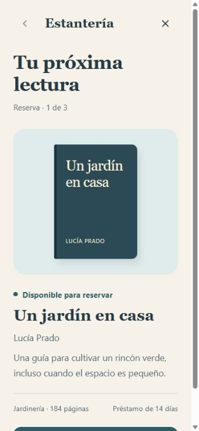
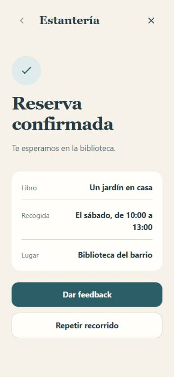

# Con mockups: reservar un libro

[English](README.md) · [Todos los ejemplos](../../README.es.md#casos-de-uso)

Conserva la dirección visual existente y permite completar la reserva.
El recibo debe contener el libro y la franja de recogida elegidos.

## Prompt

Ejecuta desde la raíz del repositorio. El prototipo conserva su interfaz en español.

```text
Usa $improve-design con examples/with-mockups/mockup.jpg como referencia.
Conserva su tipografía, colores, espaciado y contenido.
Construye la reserva completa: disponibilidad, recogida, revisión,
confirmación y recibo. Mantén la interfaz en español.
Presenta el escenario antes de Iniciar y recoge feedback después del resultado.
Guarda la propuesta en review/book-reservation/.
```

## Capturas

| Mockup de referencia | Resultado final |
| --- | --- |
|  |  |

La referencia se creó a partir del estado inicial del ejemplo, con los mismos
datos y componentes. No es una reproducción independiente de un archivo de diseño
externo. Los estados posteriores amplían la misma dirección visual.

## Probar el prototipo

Descarga este ejemplo y abre `index.html` en tu navegador. El
[enlace de GitHub](index.html) muestra el código del archivo. Lee la ficha y
selecciona **Iniciar recorrido**.

1. Abre la reserva del libro disponible.
2. Elige una franja de recogida.
3. Revisa los datos. Vuelve atrás si quieres cambiar la franja.
4. Confirma y comprueba que el recibo conserva tu elección.
5. Selecciona **Dar feedback**. También puedes salir antes para una revisión parcial.

Volver conserva la selección. Reiniciar restablece la reserva simulada y mantiene
los comentarios. Llegar al recibo completa el recorrido.

Las reservas son ficticias. El feedback permanece en este navegador cuando
dispone de almacenamiento y se puede exportar. No llega automáticamente al agente.
