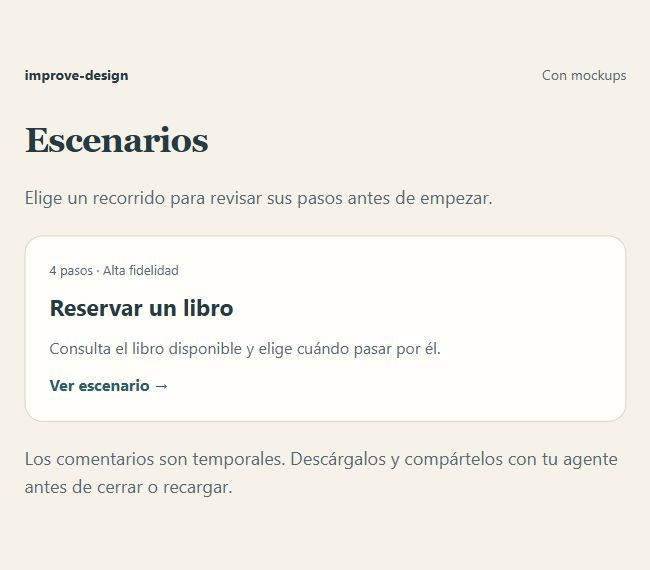
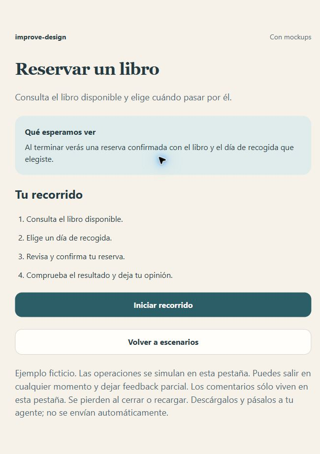
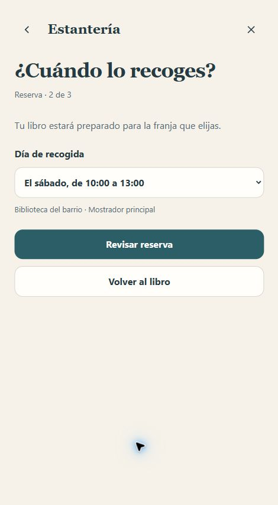
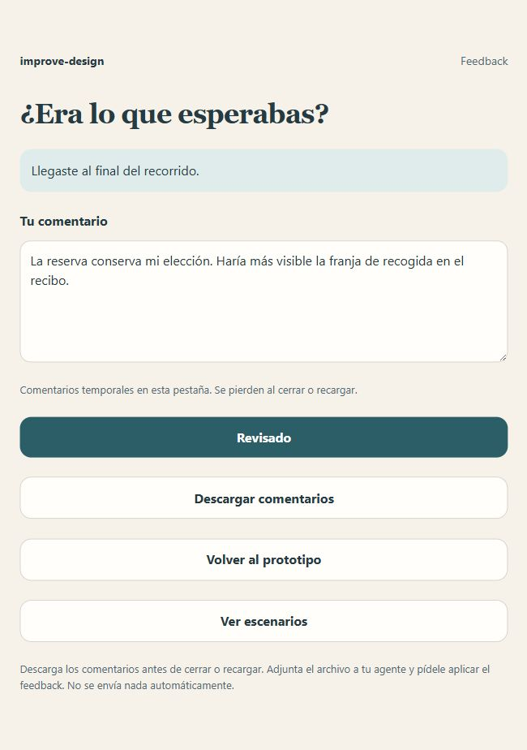

# Con mockups: reservar un libro

[English](README.md) · [Todos los ejemplos](../../README.es.md#casos-de-uso)

## Prompt

```text
Usa $improve-design con examples/with-mockups/mockup.jpg como referencia.
Muestra lista y detalle del escenario; inicia la reserva completa,
confirma la recogida y muestra el formulario de feedback.
```

## Capturas

| 1. Lista de escenarios | 2. Detalle del escenario |
| --- | --- |
|  |  |

| 3. Escenario interactivo | 4. Formulario de feedback |
| --- | --- |
|  |  |

[Mockup de referencia](mockup.jpg). Se creó desde el estado inicial de este ejemplo; no representa una traducción independiente.

## Probar

Descarga este ejemplo y abre `index.html` en tu navegador. GitHub muestra el código del [archivo](index.html). Elige el escenario, lee sus pasos, pulsa Iniciar y completa el recorrido hasta su resultado; después deja feedback.

Los comentarios son efímeros y viven en esta pestaña. Navegar y repetir los conserva; cerrar o recargar los pierde. Descarga el archivo Markdown antes de salir y adjúntalo a tu agente o pega su contenido como prompt. No se envía automáticamente.

Las operaciones son ficticias.
