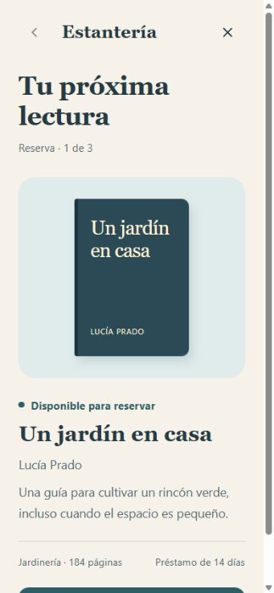
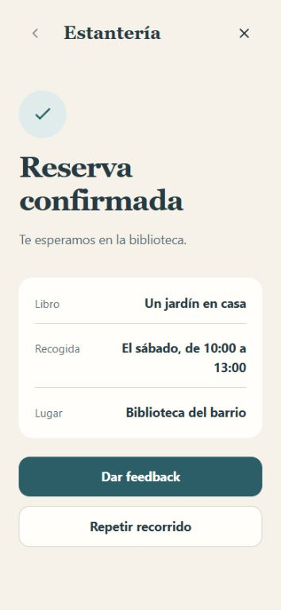

# With mockups: reserve a book

[Español](README.es.md) · [All examples](../../README.md#use-cases)

Preserve the existing visual direction and let the user complete the reservation.
The receipt must contain the selected book and collection window.

## Prompt

Run from the repository root. The prototype keeps its Spanish interface copy.

```text
Use $improve-design with examples/with-mockups/mockup.jpg as the reference.
Preserve its typography, colors, spacing, and content.
Build the full reservation flow: availability, collection window, review,
confirmation, and receipt. Keep the interface in Spanish.
Present the scenario before Start and collect feedback after the final result.
Save the proposal under review/book-reservation/.
```

## Screenshots

| Reference mockup | Final result |
| --- | --- |
|  |  |

The reference was created from this example's initial state with the same data
and components. It is not an independent reproduction of an external design file.
Later states extend the same visual direction.

## Try the prototype

Download this example and open `index.html` in your browser. GitHub's
[index.html link](index.html) shows the source file. Read the introduction and
select **Iniciar recorrido**.

1. Open the available book's reservation.
2. Choose a collection window.
3. Review the details. Go back if you want to change the window.
4. Confirm and check that the receipt preserves your selection.
5. Select **Dar feedback**. You can also exit earlier for a partial review.

Back preserves the selection. Replay resets the simulated reservation and keeps
comments. Reaching the receipt completes the journey.

Reservations are fictitious. Feedback stays in this browser when storage is
available and can be exported. It does not reach the agent automatically.
