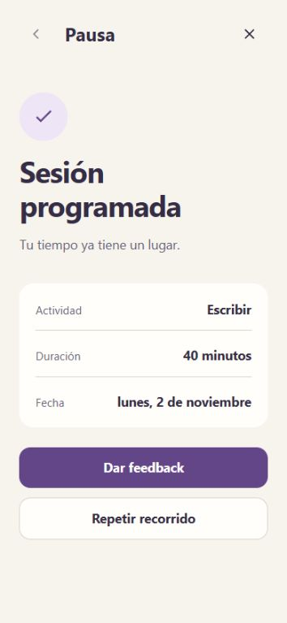

# Sin mockups: programar una sesión

[English](README.md) · [Todos los ejemplos](../../README.es.md#casos-de-uso)

Crea una dirección visual terminada y permite programar una sesión.
El resultado final debe conservar la actividad, duración y fecha elegidas.

## Prompt

Ejecuta desde la raíz del repositorio.

```text
Usa $improve-design para crear un planificador sencillo de concentración.
No tengo mockups. Diseña una interfaz coherente de alta fidelidad en español.
Déjame elegir actividad, indicar duración y fecha, revisar, confirmar
y ver la sesión programada antes de dar feedback.
Incluye validación útil y navegación hacia atrás que conserve mis elecciones.
Guarda la propuesta en review/focus-session/.
```

## Capturas



El ejemplo define su dirección visual: fondo marfil, texto ciruela,
controles lavanda, tipografía del sistema y componentes comunes en cada estado.
No hace falta un mockup separado para comenzar.

## Probar el prototipo

Descarga este ejemplo y abre `index.html` en tu navegador. El
[enlace de GitHub](index.html) muestra el código del archivo. Lee la ficha y
selecciona **Iniciar recorrido**.

1. Elige una actividad.
2. Indica duración y fecha. Prueba una duración menor de 10 minutos para ver la validación.
3. Revisa los datos y confirma.
4. Comprueba que el resultado conserva la actividad, duración y fecha elegidas.
5. Selecciona **Dar feedback**. También puedes salir antes para una revisión parcial.

Volver conserva las entradas. Reiniciar restablece la sesión simulada y mantiene
los comentarios. Llegar al resultado de sesión programada completa el recorrido.

La sesión no crea un evento de calendario real. El feedback permanece en este
navegador cuando dispone de almacenamiento y se puede exportar. No se envía
al agente ni a otro dispositivo.
