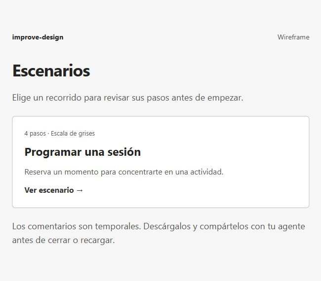
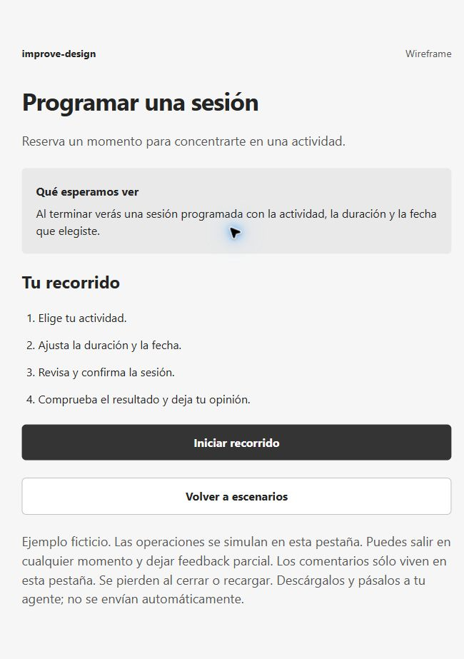
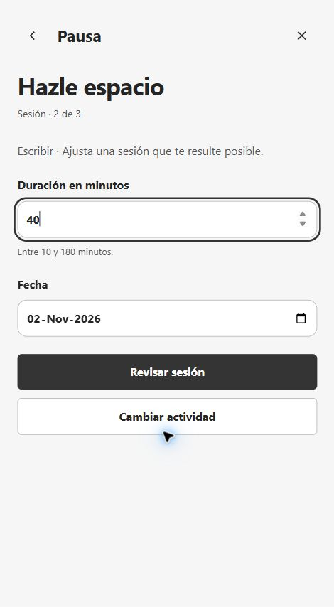
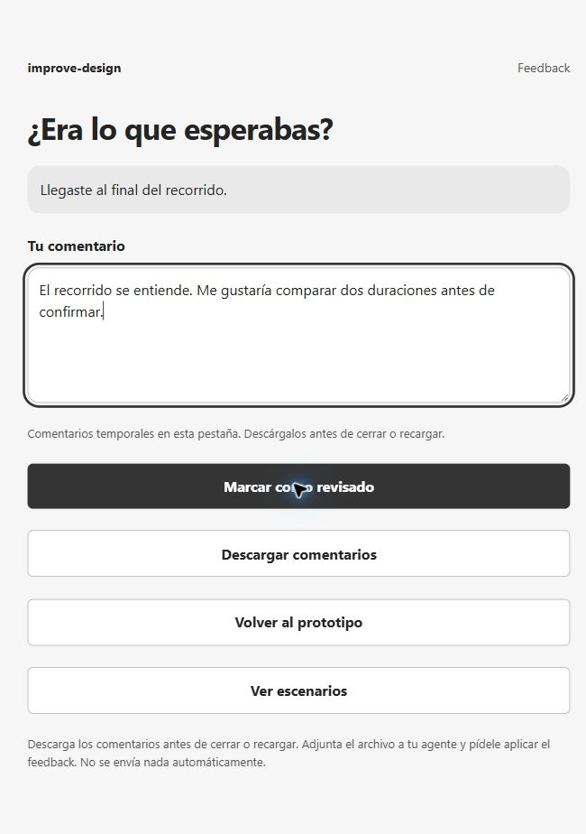

# Grayscale wireframe: schedule a focus session

[Español](README.es.md) · [All examples](../../README.md#use-cases)

## Prompt

```text
Use $improve-design to create a grayscale focus-session wireframe.
Show scenario list and details; start, schedule the session
through confirmation, and show the feedback form.
```

## Screenshots

| 1. Scenario list | 2. Scenario details |
| --- | --- |
|  |  |

| 3. Interactive scenario | 4. Feedback form |
| --- | --- |
|  |  |


## Try it

Download this example and open `index.html` in your browser. GitHub displays the [source file](index.html). Select the scenario, read its steps, press Start, and complete the journey through its result before giving feedback.

Comments are ephemeral and live in this tab. Navigation and replay retain them; closing or reloading loses them. Download the Markdown file before leaving and attach it to your agent or paste its contents as a prompt. Nothing is sent automatically.

Operations are fictitious.
